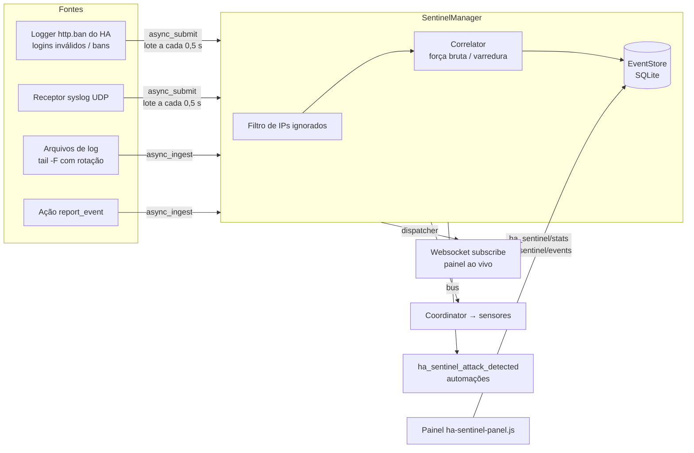

# Arquitetura



## Estrutura do repositório

```
custom_components/ha_sentinel/
├── engine/              # Motor puro Python — SEM dependência do Home Assistant
│   ├── models.py        #   AttackEvent, AttackType, Severity
│   ├── rules.py         #   parsers + regras de classificação (regex)
│   ├── correlator.py    #   correlação com janelas deslizantes e LRU
│   ├── store.py         #   SQLite (WAL), consultas e agregações
│   └── tailer.py        #   leitura incremental com detecção de rotação
├── sources/             # Adaptadores HA → motor
│   ├── ha_auth.py       #   logging.Handler no logger homeassistant.components.http.ban
│   ├── log_files.py     #   polling dos arquivos (I/O no executor)
│   └── syslog.py        #   asyncio DatagramProtocol, allowlist e rate limit
├── manager.py           # Orquestração: filtro → correlação → gravação → fan-out
├── coordinator.py       # DataUpdateCoordinator dos sensores (60 s + debounce em novos eventos)
├── sensor.py / binary_sensor.py
├── websocket_api.py     # ha_sentinel/info | stats | events | subscribe (admin)
├── services.py          # report_event | purge_events | generate_test_events
├── panel.py             # rota estática + painel na barra lateral
├── config_flow.py       # setup + opções em seções (com reload automático)
├── diagnostics.py       # diagnóstico com dados sensíveis redigidos
└── frontend/ha-sentinel-panel.js   # Web Component sem dependências / sem build
tests/
├── engine/              # testes unitários do motor
└── test_integration.py  # sobe a integração num Home Assistant real (pytest-homeassistant-custom-component)
```

## Decisões

| Decisão | Motivo |
|---|---|
| **Integração (custom component)** em vez de add-on | Funciona em todas as instalações (OS, Container, Core, Supervised), distribui via HACS e tem acesso direto aos eventos de autenticação do HA. Um add-on pode ser acrescentado depois para fontes que exigem acesso ao host (ver roadmap). |
| **Motor sem dependência do HA** | Testável isoladamente, reutilizável por um futuro add-on/CLI. |
| **SQLite próprio** em vez do recorder | Eventos de ataque podem ter alto volume; não incha o banco do recorder, permite consultas agregadas específicas e retenção independente. |
| **Logging handler** para logins do HA | O HA não emite evento no barramento para falha de login; o logger `http.ban` cobre frontend, REST, websocket e banimentos sem alterar o core. Se o usuário silenciar avisos, o nível só desse logger é reduzido para WARNING e restaurado no unload. |
| **Detecção de formato automática** | Um único campo de caminhos e o syslog aceitam conteúdo misto; menos configuração. |
| **Painel Web Component vanilla** | Sem etapa de build, sem CDN (funciona offline), carregamento rápido. Gráficos em SVG próprio. |
| **Paleta de severidade validada** | Azul/amarelo/vermelho/violeta verificada para daltonismo nos temas claro e escuro; severidade sempre acompanha rótulo de texto. |
| **Eventos no barramento só a partir de uma severidade** (padrão *alta*) | Evita inundar o barramento/recorder com bloqueios de firewall de baixa severidade. |

## Pontos de atenção
- Timestamps usam a hora de ingestão (os arquivos começam a ser lidos do fim; histórico não é reimportado).
- Requisições HTTP 401 comuns não são classificadas em logs de proxy (gerariam falso positivo com tokens
  expirados); logins inválidos vêm do próprio HA.
- O receptor syslog limita a 2.000 linhas/s e cada lote de arquivo a 5.000 eventos.
- O correlator mantém no máximo 10.000 IPs em memória (LRU).
